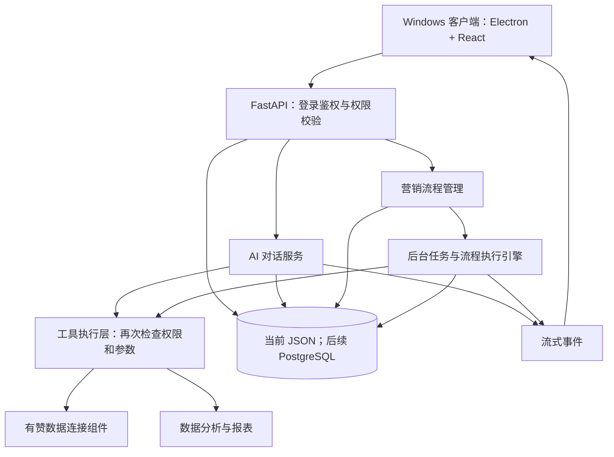
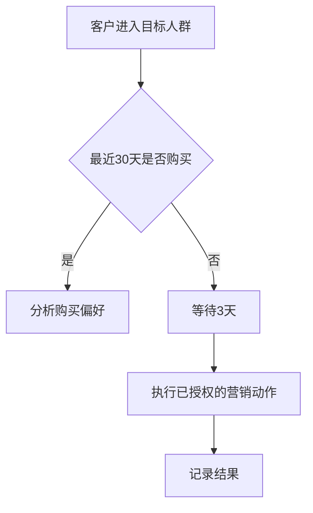

> 2026-11-10 部署更新：生产后端和业务 CLI 仅在远程服务器运行，本地启动、联调及浏览器运行环境已移除。以下含历史设计说明；当前运行方式以 deploy/README.md 和 backend/README.md 为准。

# galaxy ai · 客户端与服务端技术方案

更新日期：2026-11-08  
状态：技术方向已确定，作为后续设计与开发的基础；具体依赖版本在项目初始化时锁定。

## 1. 产品目标

产品正式命名为 **galaxy ai**。搭建自己的 AI 业务工作台：用户通过 Windows 客户端登录，与 AI 聊天；AI 在用户权限范围内调用工具查询数据、进行分析，并展示图表和报表。

客户端按身份和店铺授权展示不同内容，支持界面特效。后续逐步加入营销画布等业务功能，界面以 HTML、CSS、TypeScript 为主体，保留未来提供网页版的能力。

## 2. 确定的技术组合

| 层级 | 技术 | 主要用途 |
| --- | --- | --- |
| Windows 桌面容器 | Electron | 窗口、托盘、通知、本地文件保存等桌面能力 |
| 界面框架 | React | 聊天、工具结果、营销画布、报表和配置页面 |
| 前端语言 | TypeScript | 规范组件、接口和流程数据类型 |
| 前端构建 | Vite | 前端开发和构建 |
| 样式 | HTML、CSS、Tailwind CSS | 页面布局、主题、视觉效果和样式管理 |
| 基础组件 | shadcn/ui | 可定制的表单、对话框、菜单等组件 |
| 营销流程编辑器 | React Flow | 节点、连线、拖拽、缩放、自定义节点和状态展示 |
| 动画 | Motion＋CSS | 消息出现、卡片展开、页面切换、布局过渡 |
| 数据可视化 | ECharts | 销售、客户行为、趋势等分析图表 |
| 服务端接口 | FastAPI＋Python | 登录鉴权、聊天接口、权限校验、数据查询和分析 |
| 当前存储 | JSON＋文件锁＋原子写入 | 第一阶段保存用户、权限、会话；随着业务增加迁移 PostgreSQL |
| 聊天流式输出 | HTTP 流式响应，采用 SSE 事件格式 | AI 文字增量、工具调用状态、任务进度和结果 |
| 后台任务 | 独立任务进程＋持久任务记录 | 批量取数、登录维护、定时任务和报表生成 |
| 有赞连接组件 | 现有 Chromium／Playwright＋Python 程序 | 会话维护、接口访问与数据接入 |

任务队列、调度引擎和模型供应商的具体产品尚未选定，后续按任务规模与执行需求决定。Three.js 作为未来复杂三维效果的可选项，第一版不引入。

## 3. 整体架构

## 4. 客户端职责

- 登录界面及当前用户身份、店铺范围展示。
- AI 聊天、历史会话、流式回复和工具执行状态。
- 表格、图表、分析结果及文件下载。
- 营销画布编辑、节点配置、流程预览和执行结果展示。
- 主题、动画、桌面通知、窗口及文件操作。

React 业务组件与 Electron 桌面能力分开：业务组件通过接口访问服务端，桌面能力通过受限的 preload／IPC 接口提供。界面进程启用上下文隔离，不直接开放 Node.js 能力。

这种组织方式让大部分业务页面可以复用于网页版，桌面专属能力使用独立适配层。

## 5. 服务端职责

- 自有产品的用户登录、会话管理、注销和权限校验。
- AI 模型调用、会话上下文和工具编排。
- 有赞登录状态、数据接口访问和异常处理。
- 业务数据加工、统计分析、报表生成。
- 营销流程持久化、版本管理、调度、执行和日志。
- 用户操作、工具执行和任务结果的审计记录。

模型 API Key、有赞账号密码、Cookie 和浏览器状态保存在服务端。面向普通客户端的业务接口不返回这些凭证原值。

自有客户端登录和有赞登录是两套独立的认证体系：用户登录本产品后，服务端根据授权关系决定其可以使用哪些有赞连接和店铺。

## 6. 身份与数据权限

使用“角色权限＋店铺数据范围”。角色名称和细分权限后续确认，以下为初始设计示例：

| 身份示例 | 功能范围 | 数据范围 |
| --- | --- | --- |
| 管理员 | 用户管理、权限配置、工具配置、流程管理 | 被授权的全部店铺 |
| 店长 | 店铺查询、分析、报表和被授权的营销功能 | 自己负责的店铺 |
| 员工 | 被授权的查询和分析功能 | 指定店铺及允许查看的字段 |

前端根据权限显示功能，服务端执行实际权限校验。每次工具调用都从服务器认证上下文取得用户和店铺范围，不信任客户端或模型自行声明的身份与权限。

查询、导出、创建流程、发布流程和执行营销动作分别授权。聊天记录、任务和报表同样按照所属用户及授权范围隔离。

## 7. AI 工具调用

一次典型调用过程：

1. 客户端提交用户消息与会话标识。
2. 服务端验证用户身份，确定可使用的工具和店铺范围。
3. AI 生成结构化工具调用。
4. 工具执行层验证参数及数据权限后执行。
5. 将业务结果交给 AI 分析，并向客户端推送进度和最终结果。

工具使用明确的数据结构，例如客户查询、客户时间轴、订单查询、店铺信息、报表生成。AI 不直接获得任意 Shell 或数据库执行权限。

服务端统一生成事件类型，例如文字增量、工具开始、工具完成、任务进度、任务失败和回复完成。取消请求、断线恢复和长任务状态通过任务标识衔接；长任务不依赖聊天连接持续存在。

## 8. 营销画布

画布界面采用 React Flow，自定义节点使用 React 组件，可以包含 HTML 表单、按钮、统计信息和执行状态。

流程示例：

### 编辑与执行分工

| 层级 | 负责内容 |
| --- | --- |
| 客户端画布 | 编辑节点、连线、配置条件、预览和展示结果 |
| 服务端流程管理 | 校验流程、保存草稿和版本、管理发布与暂停 |
| 服务端执行引擎 | 触发条件、人群查询、分支判断、等待、动作执行和结果记录 |

流程运行在服务端，客户端关闭后任务继续。等待节点必须持久化，任务进程重启后可恢复；动作执行需要处理重复投递和重试，避免重复触达。

### AI 与画布共用数据

使用带版本号的结构化流程定义，包含节点、连线、节点配置和引用资源。界面布局信息与执行配置分别组织。

AI 创建或修改流程草稿，画布展示同一份流程；用户手动修改后，AI 可以读取更新后的定义。发布时服务端检查节点类型、配置、连线和权限，执行实例绑定明确的已发布版本。

后续研究有赞营销画布时，逐项整理其业务规则、接口和数据结构，再实现自己的页面和连接工具。哪些动作可以独立执行，以对应接口和实际授权能力为准。

## 9. 现有有赞程序的接入

现有固定入口是 `youzan-login.sh`，使用真实 Chromium 和持久化浏览器目录。已验证一次完整登录成功及后续会话复用，但跨到期重新登录和服务器无桌面部署尚需验证。

接入服务端时：

- 每个有赞账号使用独立浏览器目录和状态文件。
- 同一账号的登录任务串行执行，避免多个进程同时操作同一目录。
- 由连接组件提供统一的会话检查与登录入口。
- 业务工具通过连接组件获取可用会话，不自行散落读取 Cookie 文件。
- 遇到需要短信等交互验证时，向客户端返回明确状态并进入人工协助流程。
- CRM 的 CSRF 获取和有赞会话登录分别处理，不能把 CSRF 更新等同于 sid 续期。

## 10. 第一版范围

1. Windows 客户端、基础主题与聊天布局。
2. 自有用户登录、角色与店铺权限。
3. 流式聊天、工具执行进度和历史记录。
4. 接入已有有赞查询工具，展示表格和图表。
5. 后台任务状态、报表生成与下载。
6. 在以上基础上加入营销画布编辑、流程保存和执行能力。

当前文档记录技术方向，不代表上述功能已经实现。

### 当前落地进度（2026-11-08）

Arch Linux 已部署 FastAPI 登录后端，先用 JSON 存储。`1.txt` 每两行一组账号密码，第一组为管理员、后续为员工；已导入管理员和第二个员工账号。密码使用 Argon2id，服务端只存会话 token 的摘要。Windows 客户端通过 HTTPS 登录；记住登录使用 Windows 系统加密保存会话，固定有效期 30 天。账号和角色权限从服务器读取。

界面按当前要求：透明登录表单，仅登录页显示下载目录 `1.mp4` 转换后的背景视频。登录后进入深色工作台，左侧为头像、身份与模块导航，AI 是其中一个模块。AI 头像使用用户提供的 `AI.png`。新建对话和历史图标放在右侧 AI 标题栏，历史展开为右侧抽屉；头像菜单可退出登录。

管理员和员工共用 Windows 客户端。管理员新增“控制台 → AI / 有赞”，AI 页面顶部划分“AI 模型 / 全局提示词”两个标签，分别管理连接、默认模型、一键测试和全局规则；工作台使用中性黑白灰配色。有赞页面先预留连接管理入口。已接通 Chat Completions 兼容接口及个人聊天历史，当前按完整回复展示。供应商凭证加密保存于服务器，系统提示词由服务器注入。流式回复、MCP 工具、在线用户管理和营销画布尚待接入。详见 [AI 接入说明](backend/AI接入说明.md)。

MCP 工具定义可共用，用户凭证和连接状态分别归属于 `workspace_id + user_id + tool_id + connection_id`，防止不同员工共用全局 token 或浏览器状态。设计和验收条件见 [MCP 用户凭证隔离设计](backend/MCP用户凭证隔离设计.md)。部署、接口、存储和迁移说明见 [backend/README.md](backend/README.md)。

基础命令工具入口命名为 `galaxy-cli`，兼容别名 `galax-cli`。当前已实现工具注册表和首个 `help` 工具，可输出全部已注册工具的名称、说明、输入和输出 JSON Schema。后续工具按模块自动注册到帮助列表，使用统一 JSON 参数调用。

权限令牌按用户确认的后续方向设计：登录后从后端取得权限令牌，由 CLI 保存并在工具请求时自动携带；接收请求的后端／工具服务验证令牌和工具权限，未授权访问会被拒绝。令牌下发仍待实现。

当前已接通聊天自动工具调用：模型仅获得 `galaxy_cli` 函数，后端固定启动 CLI、校验参数及当前登录权限，只允许已授权的 `help`，并记录审计和界面调用结果。新工具注册和执行授权分别管理。使用及注册说明见 [Galaxy CLI](galaxy-cli/README.md)，执行边界见 [工具执行权限](backend/Galaxy工具执行权限.md)。

## 11. 参考资料

- [Electron 进程模型](https://www.electronjs.org/docs/latest/tutorial/process-model)
- [Electron 安全建议](https://www.electronjs.org/docs/latest/tutorial/security)
- [React Flow](https://reactflow.dev/)
- [React Flow 自定义节点](https://reactflow.dev/examples/nodes/custom-node)
- [Motion](https://motion.dev/docs/)
- [FastAPI 权限范围](https://fastapi.tiangolo.com/advanced/security/oauth2-scopes/)
- 项目内已有文档：[固定登录程序使用说明](session_research/固定登录程序使用说明.md)
